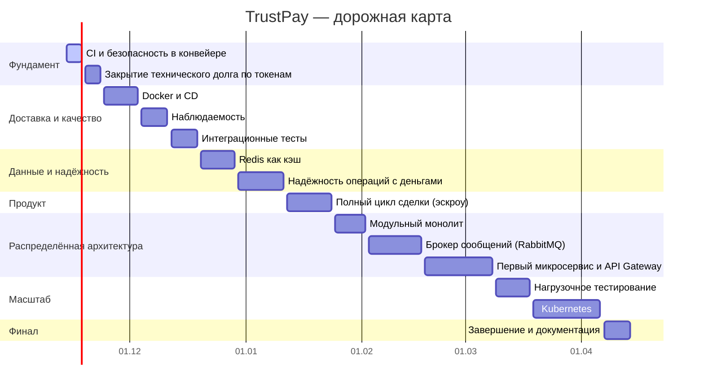

# Дорожная карта TrustPay

TrustPay — биржа цифровых услуг (аналог FunPay) с безопасной сделкой. Проект учебный: цель — на реалистичной предметной области освоить современную backend-разработку на C# и .NET и довести монолит до распределённой, наблюдаемой и проверенной под нагрузкой системы.

**Принцип:** сначала надёжность и автоматизация монолита, потом распределённость. Микросервисы строятся поверх того, что уже умеем проверять, развёртывать и наблюдать.

## Что уже есть

- Clean Architecture (Domain / Application / Infrastructure / Api), DDD, CQRS на MediatR, FluentValidation
- ASP.NET Core на .NET 10, EF Core, PostgreSQL, документация API через Scalar/OpenAPI
- Аутентификация: JWT, refresh-токены с хэшированием и ротацией, пароли на Argon2, проверка прав «владелец или администратор»
- Безопасность: секреты вне репозитория (user-secrets, `.env`), маскирование чувствительных данных в логах (Serilog), Push protection на GitHub
- Кошельки, переводы, лоты, заказы, отзывы, споры, приём платёжных уведомлений с проверкой подписи (HMAC)
- Redis (фильтр Блума), Docker Compose для PostgreSQL и Redis
- Юнит-тесты (xUnit, NSubstitute, FluentAssertions) и первый CI в GitHub Actions (сборка и тесты)

## План

Допущения: **2 часа в день** (около 14 часов в неделю), к каждой оценке добавлен запас 25% на изучение и непредвиденное. Всего около 238 часов, ориентировочное завершение — **14.04.2027**. Даты — ориентир, а не обещание: план пересматривается по итогам каждого этапа.

| # | Тема | Что входит | Период | Статус |
|---|------|-----------|--------|--------|
| 1 | **CI и безопасность в конвейере** | Триггеры, кэш, проверка форматирования, покрытие тестов, поиск секретов (gitleaks), проверка уязвимых зависимостей, обязательные проверки для main | 14.11.2026 – **18.11.2026** | 🔄 в работе |
| 2 | **Закрытие технического долга по токенам** | Реакция на кражу refresh-токена, фоновая очистка просроченных токенов, уникальный индекс TokenHash, порядок настроек и сообщений | 19.11.2026 – **23.11.2026** | ⏳ запланировано |
| 3 | **Docker и CD** | Dockerfile приложения, запуск всего стека одной командой, образ в реестре, автоматическая выкладка на тестовое окружение | 24.11.2026 – **03.12.2026** | ⏳ запланировано |
| 4 | **Наблюдаемость** | Проверки работоспособности, метрики, трассировка (OpenTelemetry), структурные логи с идентификатором запроса | 04.12.2026 – **11.12.2026** | ⏳ запланировано |
| 5 | **Интеграционные тесты** | Тесты с настоящими PostgreSQL и Redis в контейнерах (Testcontainers), запуск в CI | 12.12.2026 – **19.12.2026** | ⏳ запланировано |
| 6 | **Redis как кэш** | Cache-aside для каталога и лотов, инвалидация, распределённые блокировки для денежных операций | 20.12.2026 – **29.12.2026** | ⏳ запланировано |
| 7 | **Надёжность операций с деньгами** | Идемпотентность, паттерны Outbox и Inbox, повторы и таймауты (Polly), ограничение частоты запросов | 30.12.2026 – **11.01.2027** | ⏳ запланировано |
| 8 | **Полный цикл сделки (эскроу)** | Заморозка денег, выполнение, подтверждение, споры с арбитром, выплата продавцу | 12.01.2027 – **24.01.2027** | ⏳ запланировано |
| 9 | **Модульный монолит** | Чёткие границы модулей, запрет прямых ссылок между ними, обмен через события | 25.01.2027 – **02.02.2027** | ⏳ запланировано |
| 10 | **Брокер сообщений (RabbitMQ)** | Публикация и подписка, надёжная доставка, повторная обработка без дублей, интеграция с Outbox | 03.02.2027 – **17.02.2027** | ⏳ запланировано |
| 11 | **Первый микросервис и API Gateway** | Выделение первого модуля в отдельный сервис, собственная база, шлюз (YARP), согласованность данных (сага) | 18.02.2027 – **08.03.2027** | ⏳ запланировано |
| 12 | **Нагрузочное тестирование** | Сценарии на несколько тысяч пользователей (k6), поиск узких мест, оптимизация запросов и индексов | 09.03.2027 – **18.03.2027** | ⏳ запланировано |
| 13 | **Kubernetes** | Развёртывание сервисов, пробы здоровья, масштабирование, конфигурация и секреты в кластере | 19.03.2027 – **06.04.2027** | ⏳ запланировано |
| 14 | **Завершение и документация** | Сквозной сценарий, описание архитектуры и решений (ADR), итоги нагрузочных испытаний, README | 07.04.2027 – **14.04.2027** | ⏳ запланировано |

## Как читать

- ✅ сделано, 🔄 в работе, ⏳ запланировано.
- Темы идут в порядке зависимостей: например, брокер сообщений появляется после идемпотентности и Outbox, а микросервис — после модульного монолита и RabbitMQ.
- Вехи: **CD** — тема 3, **Redis** — тема 6, **брокер сообщений** — тема 10, **микросервисы** — тема 11, **нагрузка** — тема 12, **Kubernetes** — тема 13.
